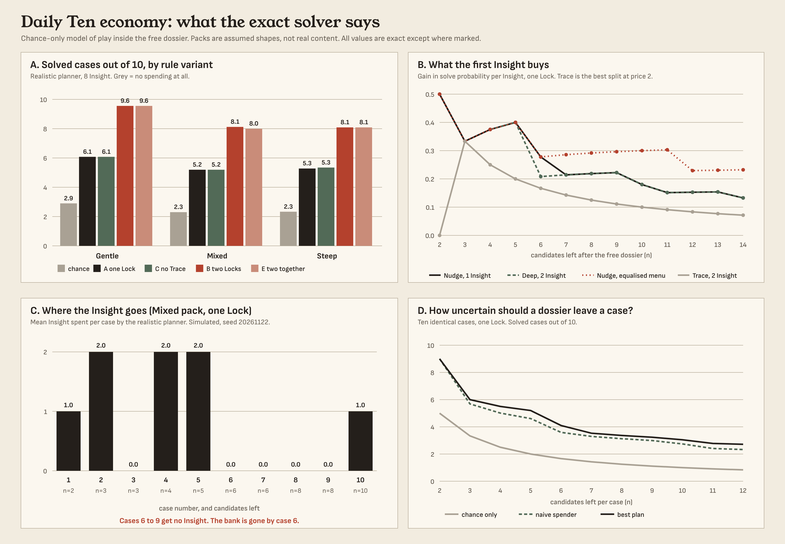

# Economy experiment

*Stage 2. What was computed, under which assumptions, and what it does and does not show. Full tables: `economy/results.md` (generated). Code: `experiments/economy/`. Nothing here is a human result.*



## 1. What was done

I built a small exact solver for the Daily Ten, tested it, and used it to compare rule variants. "Exact" means the expected values come from dynamic programming over every reachable state, not from sampling. One seeded Monte Carlo run cross-checks the solver against an explicit simulation of the same rules.

| File | Purpose |
|---|---|
| `experiments/economy/model.py` | Reference rules model: cases, shared bank, refusals, save and resume. Specification by code, not product code. |
| `experiments/economy/dp.py` | Exact solver and fixed-rule evaluator. Also the seeded simulator. |
| `experiments/economy/test_economy.py` | 23 tests: rules invariants, exact solver checks, solver against Monte Carlo |
| `experiments/economy/run_experiments.py` | The 14 experiments. Writes `docs/economy/results.md` and `results.json`. |
| `experiments/economy/make_figures.py`, `shoot.js` | Figures |

**Reproduce everything** (standard library only, plus Node for the pictures):
```bash
cd experiments/economy
python3 -m unittest -v          # 23 tests, under a second
python3 run_experiments.py      # about 30 seconds, writes docs/economy/results.md
python3 make_figures.py && node shoot.js
```
Seed for all sampling: `20261122`.

## 2. The model, and every assumption

| ID | Assumption | Why it matters |
|---|---|---|
| M1 | Cases are independent. Only the bank links them. | Result of one case never changes another. |
| M2 | After the free dossier a case has `n` candidates, the target uniform among them. The dossier is reading, not an action. | The dossier's quality is an *input* (`n`), not something solved here. |
| M3 | A paid clue is a window of `w` consecutive years containing the target, placed uniformly among positions that contain it. | Gives an exact, uniform posterior. Real clues are lumpier. |
| M4 | A clue that removes nothing is refunded. | Matches the rule in RULES_CANDIDATES.md. |
| M5 | Trace returns earlier / later / same at a fixed price. | As specified. |
| M6 | Lock is free. In two-Lock play a wrong Lock removes only that year, kept at an end of the range. | Simplifies the state. |
| M7 | **Chance-only play inside the dossier.** No reasoning skill beyond narrowing. | **Results are lower bounds on a reasoning player.** The largest limitation. |

**Pack shapes** are *assumed* residual sizes, not real content: Gentle `[2,2,3,3,4,4,5,5,6,6]`, Mixed `[2,3,3,4,5,6,6,8,8,10]`, Steep `[2,2,3,4,5,6,8,10,12,14]`. Real packs come from Stage 3.

**Clue menus** are assumed: for `n` of 3 or fewer, one Nudge; 4 to 6, a Nudge and a Deep; 7 and above, two Nudges and a Deep. A Nudge window is about `n/2` years wide (about 1 bit), a Deep about `n/4` (about 2 bits).

**Policies** (who plays):

| Policy | Meaning |
|---|---|
| Random guesser | Picks among the whole 30-year starting corridor, ignoring the dossier |
| Chance in dossier | Reads the dossier, locks a guess, never spends |
| Trace-first rule | Traces the middle until it can Lock, if affordable |
| Clue-first rule | Buys the cheapest clue first, then Trace, then Locks |
| Naive spender | Optimal inside each case but ignores the rest of the day (myopic) |
| Realistic planner | Optimal, knowing the pack's **mix** of case sizes but not their order |
| Informed planner | Optimal, knowing the exact order. An **upper bound**. |
| Prior-knowledge player | The realistic planner, who already knows the answer outright in a fraction of cases |

**Worst case and best case** use the same states with an adversary or a lucky oracle choosing every outcome.

## 3. Results that matter

### 3.1 Without spending, a player solves about a quarter; 8 Insight adds about three more cases
Chance inside the dossier solves 2.30 to 2.90 of 10 (Experiment 1). The best spending adds +2.9 to +3.2, reaching 5.2 to 6.1 of 10. For comparison, guessing in the whole 30-year corridor solves 0.33.

### 3.2 Trace at price 2 is not needed
Optimal play with Evidence only (variant C) matches or beats play with Trace at price 2 (variant A): 6.08 vs 6.08, 5.20 vs 5.20, 5.35 vs 5.28. At price 3 or more Trace is never used. At **price 1** it dominates: 6.7 uses a day and +1.16 solved cases on Mixed. Where Trace is the only tool (no clues), optimal play solves 5.17, 4.33 and 4.14, about 0.9 to 1.2 fewer cases than Evidence-only, so Trace recovers roughly 60 to 70% of the lift. **Trace-first is a weak policy** (4.5 to 5.2 solved against 5.2 to 6.1 for the realistic planner).

### 3.3 The reproduction of the earlier "63 to 70%" claim
| Case | Trace-only win, 31 years, 8 Insight, Trace 3, 2 Locks |
|---|---:|
| Exact ceiling, any strategy, no card | 35.5% (11/31) |
| Midpoint-Trace rule, no card | 35.5% |
| Exact optimal, **with** the old simulator's free 20-year opening card | **71.0%** |

The old simulator's 63 to 70% reproduces, and it came from the undisclosed free card, not from the Trace rules. With Trace at 2 Insight and 10 Insight the ceiling is 95 years, so 31 years are always won (100%). This is the "disputed claim" in the master prompt (section 3.5).

### 3.4 Allocation is a small lever in this model
| Pack | Realistic planner minus naive spender | Informed planner minus naive spender |
|---|---:|---:|
| Gentle | 0.37 | 0.54 |
| Mixed | 0.29 | 0.44 |
| Steep | 0.10 | 0.37 |

Most of the value is simply spending all 8 on informative clues. Knowing the order of cases helps, but a real player does not know it.

### 3.5 Where Insight is best spent, and the starvation problem
The first Insight buys most where a case is already nearly solved: the gain in solve probability per Insight falls from **0.50 at n = 2 to 0.13 at n = 14** (Experiment 10). Optimal play therefore spends early on the easy cases. On the Mixed pack, cases 6 to 9 get **zero** Insight on average (Experiment 9). Authoring clues so the first Nudge adds about +0.20 solve probability at every size (equalised menu) helps for `n` of 6 or more but does not remove the effect (Experiment 11).

A **per-case cap of 1 Insight** spreads Insight to 8 cases of 10 instead of 6, costing about 0.3 solved cases on Mixed and Steep and 0.02 on Gentle. A cap of 2 or 3 changes nothing (Experiment 14).

### 3.6 Reasoning skill changes what Insight is for
When some cases are solved by reasoning alone (Experiment 12), Insight is left over: 0.4 unused at 25% reasoning, 1.2 at 50%, 3.3 at 75%. The lift from spending falls from +2.9 to +1.5 cases. Insight becomes a safety net used where reasoning fails, which is where allocation could become interesting. **This is not demonstrated**, because skill is modelled as a crude fraction.

### 3.7 Two Locks mostly add guessing
One Lock (A) solves 5.2 to 6.1. Two Locks in turn (B) solve 8.1 to 9.6, and 4.6 to 5.8 even with no spending at all (Experiment 1). Halving the credit for a second-Lock solve (B50) lowers solved cases only by 0.0 to 0.65. Committing both Locks together (E) moves the solved count by at most 0.13 against B (Experiment 8).

### 3.8 Scoring
Maximising `100 x solved + 10 x clean + 5 x Insight left` solves the same number of cases as maximising solves alone. Never spending scores 49 to 64% of the best. The leftover bonus can rise to 20 points per Insight before hoarding starts (Experiment 13), so at 5 it is inert and can be dropped.

### 3.9 Best case, expected, worst case
Guaranteed solved cases out of 10 against an adversary, for the best policy that knows the pack:

| Pack | A | B | C | best case |
|---|---:|---:|---:|---:|
| Gentle | 5 | 9 | 5 | 10 |
| Mixed | 4 | 7 | 3 | 10 |
| Steep | 5 | 7 | 4 | 10 |

### 3.10 The six-case control
Six cases with the same 8 Insight (variant D) solve 4.1 to 4.8 of 6, a rate of about 0.7 to 0.8 per case against 0.5 to 0.6 for ten. That is the effect of more Insight per case, not of fatigue. **Fatigue cannot be simulated**; it needs players.

### 3.11 How much uncertainty should a dossier leave?
Experiment 4 (ten identical cases): at `n = 2` the best plan solves 9.0 of 10; at `n = 3`, 6.0; `n = 5`, 5.2; `n = 8`, 3.4; `n = 12`, 2.7. Chance alone: 5.0, 3.3, 2.0, 1.25, 0.83. The extra from 8 Insight stays between +1.9 and +4.0 across the range, and the allocation gain peaks at `n` of 4 to 6 (0.5 to 0.6 cases). Spread matters too: an extreme mix (half the cases at 2, half at 10) leaves little allocation gain (0.09), because the planner just fixes all the easy ones.

## 4. Status of the Stage 1 hypotheses

| # | Hypothesis | Model evidence | Verdict |
|---|---|---|---|
| H3 | A good allocation beats a naive one | Gain is 0.10 to 0.37 cases (realistic planner). Its own threshold was "within 0.3 means falsified". | **Not supported in the chance model** on 2 of 3 packs. Needs players, because skill and self-knowledge are what make allocation real. |
| H4 | Trace-only solves at least 15 points fewer than a policy that also buys Evidence | Trace-only is about 9 to 12 points lower (4.1 to 5.2 vs 5.2 to 6.1 of 10) | **Threshold not met.** "Trace is not dominant" is supported. |
| H1, H2, H5, H6 | Comprehension, novice reasoning, misses, session length | none | **Not testable here.** Need players. |

## 5. What this does not show

- **Whether any of it is fun.** No human has played the Daily Ten.
- **Real clue sets.** Menus and windows are assumed. Real clues are uneven and correlated.
- **Reasoning.** M7. Real players beat chance within a dossier, and what they believe about each case is what makes allocation a decision.
- **Fatigue, reading load and the feel of a miss.**
- **Order effects with real packs.** Experiment 4 shows order changes the realistic planner's result by under 0.2 on one pack.
- **Interaction with Bridge Facts.** Not modelled.

## 6. Decision table for the Stage 4 gray-box

| Option | Build? | Reason |
|---|---|---|
| **C1: one Lock, no Trace, Nudge 1 / Deep 2, cap per case as a switch** | **Yes, the default** | Simplest, nothing in the model is lost without Trace, avoids the blind second guess |
| A3: one Lock, Trace 3 | Switch | Keeps the named verb at no measured cost, if you want Trace |
| B: two Locks | Switch, for comparison only | Large gain but mostly guessing |
| Per-case cap of 1 | Switch | Fixes starvation at about 0.3 cases |
| Batched confirmation | No | No mechanical benefit |
| L3: confidence declaration | Not yet | Scoring-only; needs people first |

## 7. Honest notes on my own earlier work
- My earlier "63 to 70%" simulation hid a free opening card. This stage reproduces and explains it.
- My STRATA 1.5 evidence sheet advertised clue strength and overlap before purchase. Those labels can leak. They are removed from the rules (RULES_CANDIDATES.md section 5.1).
- My earlier recommendation of Trace 3 / 8 Insight / 2 Locks is withdrawn. It was based on the same flawed simulation.
