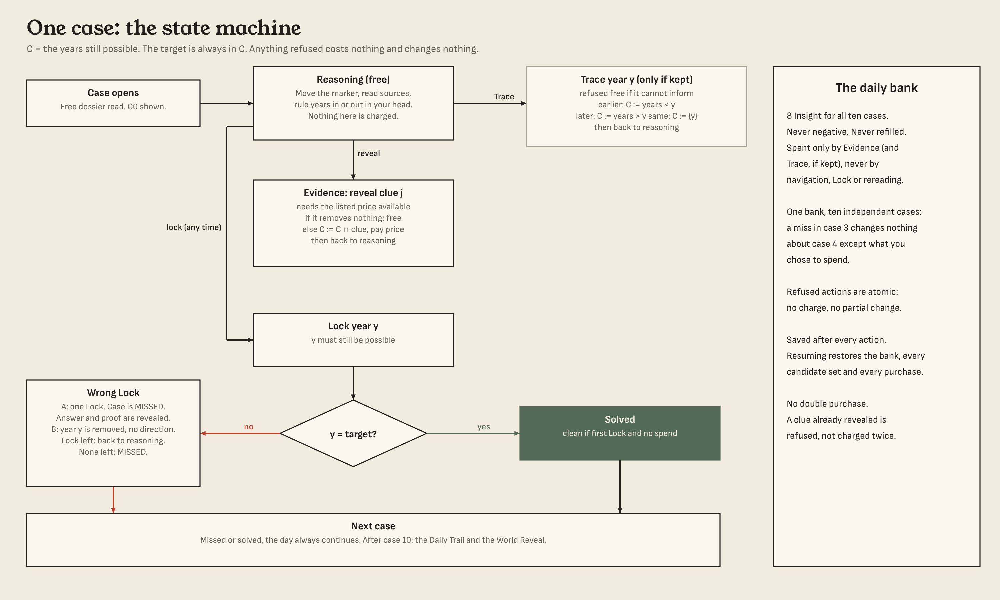

# Rules candidates for the Daily Ten

*Stage 2. Status: a proposal for approval, not an approved or playtested economy. Every number is a test value. The evidence behind it is in `ECONOMY_EXPERIMENT.md` and `economy/results.md`. The reference model that tests these rules is `experiments/economy/`.*

**Recommended variant: C1** (section 10). One Lock per case, Evidence-first, no Trace in the Daily, 8 shared Insight, result scored as solved cases.

---

## 1. Rulebook for a new player (13+)

This is the whole game for variant C1. It is under 150 words on purpose.

> **TIMEHUNT: The Daily Ten**
> Every day has ten cases. In each case, one year is hidden.
> **1. Read the evidence.** Each piece rules some years out. Slide the marker to any year to compare. This is always free.
> **2. Use your Insight.** You have 8 Insight for the whole day. It never refills. Spend 1 or 2 to reveal an extra clue. If a clue tells you nothing new, it costs nothing.
> **3. Lock a year.** You get one Lock per case. Right: solved. Wrong: you see the answer and why, and you move on. A miss never ends your day.
> **4. Save Insight for where you are stuck.**
> **5. After ten cases,** your years join into one picture you can explore.

Insight is only a game point. It is never money and cannot be bought.

---

## 2. Definitions and conventions

| Term | Meaning |
|---|---|
| Universe `U` | The integer years a case could be, for example 1960 to 1990 |
| Target `t` | The verified hidden year. Always in `U`. |
| Candidates `C` | Years still possible. **Invariant: `t` is always in `C`.** |
| Free dossier | Sourced evidence shown at the start. It is *reading*, not an action. Its machine predicates give `C0`. |
| Machine predicate | An editor-reviewed lower and/or upper bound that a clue puts on the target. Never inferred from prose at run time. |
| Dating convention | **End of year (D-009):** a clue is true for year `y` if it holds on 31 December of `y`. Any other convention must be stated on that clue. |
| Case state | `open`, `solved_clean`, `solved_assisted`, `missed` |
| Daily bank | `B = 8` Insight shared by all ten cases, never negative, never refilled |

Years are integers internally with no year zero shown to players. BCE and CE arithmetic is out of scope here and belongs to Stage 3.

---

## 3. Actions

| Action | Cost | Effect on state | Refused (and then free and unchanged) when |
|---|---:|---|---|
| Read the dossier, review sources | 0 | none | never |
| Move the marker, zoom, fit range, type a year | 0 | none, and no game truth is revealed | never |
| **Nudge** (Evidence) | 1 | `C := C ∩ clue` | already revealed; fewer than 1 Insight left to attempt it |
| **Deep clue** (Evidence) | 2 | `C := C ∩ clue` | already revealed; fewer than 2 Insight left to attempt it |
| **Trace year `y`** (only if the variant keeps it) | `τ` | earlier: `C := {c < y}`; later: `C := {c > y}`; same: `C := {y}` | `y` could not inform: it is not in `C` and `C` is not on both sides of it |
| **Lock year `y`** | 0, but limited | correct: solved. Wrong: see section 4 | `y` is already ruled out |
| Redundant contextual fact | 0 | none | never |

**Refund on redundant.** If a revealed clue turns out to remove nothing from the current `C`, it is charged **0** and shown as context. You still need its listed price available to attempt it. (Model assumption M4. It means you can never lose Insight to a clue that taught you nothing.)

**Every refused action is atomic:** no charge, no partial change. This is covered by tests in `experiments/economy/test_economy.py`.

---

## 4. State machines

*Source: `economy/state-machine.html`, generated by `experiments/economy/make_figures.py`.*

### 4.1 Case
1. **Opens** with the free dossier read. `C = C0`.
2. **Reasoning (free).** The player can move the marker and read. Each of Evidence, Trace and Lock can be chosen from here at any time.
3. **Evidence** or **Trace** change `C`, charge Insight, and return to reasoning.
4. **Lock** ends in solved, or (variant A) missed, or (variant B) removes that year and returns to reasoning if a Lock remains.
5. **Understand.** Whether solved or missed, show the year, the proof that rules out the other candidates, and the sources. Then offer the next case. A miss never ends the day.

### 4.2 Candidate gaps
After a wrong Lock in a two-Lock variant, or after any Evidence that rules out a middle band, `C` can contain gaps. Rules:
- The engine stores `C` as a set of years, not as `(min, max)`.
- The UI must never draw the span from `min C` to `max C` as one unbroken possible range.
- The exact solver restricts wrong-Lock removal to the ends of `C`. This does not change the solve probability (the posterior is uniform) but is a simplification worth re-checking with real clue sets.

### 4.3 Daily bank and failure
- `B` starts at 8 and is debited only by Evidence and Trace, in whole units, never below 0.
- Cases are independent: nothing about case 3 changes case 4 except the bank you chose to leave.
- The day never ends early. After case 10, show the Daily Trail and the World Reveal.
- State is saved after every action. Resuming restores the bank, every candidate set and every purchase. A reference model with these behaviours is tested in `model.py`.

---

## 5. Clue previews, pricing and checks

### 5.1 What may be shown before purchase (anti-leak)
Allowed: the category, the listed price, the source grade, the evidence form (text, chart, object), and a class (Broad, Focused or Precise) **computed only from the clue's authored width relative to the universe**.

Not allowed: anything computed from the current `C` or the hidden year. That includes "strong on your range", the cut location, direction, how many years remain, and whether a clue overlaps another.

**Correction to my earlier work.** My STRATA 1.5 evidence sheet showed "Strong on your range" and "Overlaps with Spaceflight" before purchase. Those depend on where a clue falls, so they can leak. Master prompt section 3.3 forbids this. They must be removed from the design.

### 5.2 Pricing rule (hypothesis)
Price by *expected information at authoring time*, not by topic:
- **Nudge: about 1 bit** (cuts the dossier's candidates roughly in half), **1 Insight**.
- **Deep: about 2 bits**, **2 Insight**.
- Trace, if kept, can give at most 1 bit, so at price 2 it gives at most 0.5 bit per Insight.

Exact marginal values for a clue window on `n` candidates are in `economy/results.md`, Experiment 10. The gain in solve probability per Insight falls from 0.50 at n = 2 to 0.13 at n = 14.

### 5.3 Pack lint (exact checks that must pass before a case ships)
1. The target is inside every clue window. (A clue that removes the target is an editorial error.)
2. Every paid clue removes at least one year from `C0`. Otherwise it is worthless on arrival and must become free context.
3. Two clues in the same correlation group are never both offered as paid.
4. The free dossier alone leaves the target in `C0`, and a **uniqueness proof** exists (section 9).
5. Dating convention is recorded for every clue.

---

## 6. Variants compared

Names follow the lab code. The master prompt's "C" (one Lock plus confidence) is called **L3** here to avoid a clash.

| Variant | Locks per case | Trace | Notes |
|---|---|---|---|
| A | 1 | price 2 | The master prompt's first experiment |
| A3 | 1 | price 3 | Trace as a rarely-used valve |
| Acap | 1 | price 2, at most 1 per case | |
| B | 2, one after the other | price 2 | The wrong first Lock removes only that year |
| B50 | 2 | price 2 | Second-Lock solve is worth 50% of a first-Lock solve |
| **C** | **1** | **none** | **Evidence-first. Recommended.** |
| D | 1 | price 2 | Six cases with the same 8 Insight, as a fatigue control |
| E | 2 | price 2 | Both Locks committed together, no feedback in between |
| L3 | 1 plus a confidence declaration | | Scoring-only; changes no solve probability. Not simulated. Test with players. |

Solved cases out of the pack, realistic planner, 8 Insight (exact):

| Variant | Gentle (10) | Mixed (10) | Steep (10) |
|---|---:|---:|---:|
| Chance only (A, no spending) | 2.90 | 2.30 | 2.33 |
| **A** | 6.08 | 5.20 | 5.28 |
| A3 | 6.08 | 5.20 | 5.35 |
| **C** | 6.08 | 5.20 | 5.35 |
| B | 9.56 | 8.12 | 8.09 |
| B50 | 9.56 | 7.95 | 7.44 |
| E | 9.56 | 7.99 | 8.09 |
| D (six cases) | 4.77 of 6 | 4.13 of 6 | 4.14 of 6 |

Reading it:
- **Trace at price 2 adds nothing measurable** over no Trace (rows A and C are equal or within 0.07).
- **Two Locks add about 3.5 solved cases, mostly by guessing.** Without any spending, B solves 5.80, 4.60 and 4.66 of 10.
- **B50 only partly deters blind second guesses.** Halving the credit for a second-Lock solve lowers solved cases by 0.00 (Gentle), 0.17 (Mixed) and 0.65 (Steep) against B, because the planner shifts some Insight to winning on the first Lock. It still solves 7.4 to 9.6 of 10, far above one Lock (5.2 to 6.1).

---

## 7. Batched confirmation (the Return of the Obra Dinn idea)

Return of the Obra Dinn confirms fates only in sets of three, so brute-forcing a single answer gets no feedback. Two places this could apply:

**Within a case (Locks committed together, variant E).** E commits both Locks at once. Solved cases: Gentle 9.56 vs B 9.56, Mixed 7.99 vs 8.12, Steep 8.09 vs 8.09. The largest difference is **0.13 cases**. Withholding in-case feedback does not remove the blind-second-guess advantage, because the advantage comes from covering two years, not from learning after the first.

**Across cases (reveal answers in sets of three).** Cases are independent (M1). The state of case 4 does not include the result of case 3, only the Insight left. So delaying confirmation cannot change any optimal decision or the expected number solved. It changes only how the day *feels*. It would matter if a solved case changed a later one (Bridge Facts). That interaction is not modelled.

**Conclusion.** Do not adopt batched confirmation as a rules fix. Its only possible value is emotional pacing and is a Stage 5 test.

---

## 8. Scoring candidates and exploit analysis

| Candidate | Formula |
|---|---|
| S0 | Solved cases (out of 10). Insight left shown as a statistic and a tie-break. |
| S1 | `100 x solved + 10 x clean solves + 5 x Insight left` (from the master prompt) |
| Rejected | `1000 + 100 x Insight + 150 x Locks` (master prompt section 1.3) |

Exact results (informed planner):

| Test | Result |
|---|---|
| Does maximising S1 change how many cases get solved? | No. Solved counts match to three decimals, except one pack where they differ by 0.02. |
| Does hoarding Insight pay? | No. A player who never spends scores **49 to 52%** of the best under A and 60 to 64% under B. |
| How big can the leftover bonus get before hoarding starts? | No change up to **20 points per Insight**. At 40, the best play leaves 3.0 Insight unspent and solves 1.0 fewer case. |
| Is blind Locking a way to score? | Under A: whole-corridor guessing solves 0.33 of 10, in-dossier chance 2.3 to 2.9. Under B: in-dossier chance 4.6 to 5.8. |
| Do the "clean solve" and "unused Lock" bonuses do anything? | Under A every solve is clean, so the clean bonus is inert. Unused-Lock bonuses are rejected. |

**Recommendation:** score **solved cases** and show Insight left beside it. Drop the clean-solve bonus. Keep any leftover bonus at or below 5 per Insight, or none. Share card, spoiler-free: `TIMEHUNT Daily 042: 7/10, 2 Insight left`.

---

## 9. Content rules this economy forces on Stage 3

The key finding (D-013) is that the free dossier carries about 95% of the information. These rules follow.

1. **Uniqueness proof.** Every case carries an editor-reviewed explanation of why each other candidate fails. Without it, a case that leaves `k > 1` candidates is a chance guess, because the model's `C` only holds *formal* constraints. This proof also powers the miss explanation from Stage 1.
2. **Derivable at zero Insight.** A reasonably engaged novice must be able to reach the target from the free dossier. Tested with people in Stage 5, not by simulation.
3. **No coin-flip pairs.** A dossier that leaves exactly two candidates with no discriminating rationale is not allowed.
4. **Authoring target (hypothesis):** 3 to 6 candidates left by the machine predicates, so there is a visible set to reason over.
5. **Clue menus of 1 to 3 clues**, authored as Nudge (about 1 bit) and Deep (about 2 bits). Do not add a clue that cuts nothing from `C0`.
6. **Equalise returns where possible** (n of 6 or more). Experiment 10 shows the gain per Insight otherwise falls fourfold from small to large `n`, which pulls Insight to the easiest cases.
7. **End-of-year dating**, recorded per clue.
8. **No pre-purchase strength or overlap labels** (section 5.1).

---

## 10. Recommendation: variant C1

| Setting | Value |
|---|---|
| Cases per day | 10 |
| Shared bank | 8 Insight, never refilled |
| Locks per case | **1** |
| Trace | **Not in the Daily.** May be offered in Practice or an advanced mode. If it must stay, price it at 3. Never at 1: at price 1, Trace is used 6.7 times a day and wins (Experiment 3). |
| Evidence | Nudge 1, Deep 2, refund when redundant |
| Per-case Insight cap | **Proposed to test: 1 per case.** It spreads Insight across 8 of 10 cases instead of 6, at a cost of about 0.3 solved cases on Mixed and Steep and 0.02 on Gentle. A cap of 2 or 3 changes nothing. |
| Scoring | Solved cases, Insight left shown |
| Practice | Unlimited, never spends the daily bank |

### Explicit weaknesses
1. **The model has no reasoning skill.** It plays by chance inside the dossier. Real players will do better, and then Insight becomes a safety net used where they are unsure (Experiment 12: at 75% reasoning, 3.3 Insight go unused). Whether allocation is *interesting* is not shown.
2. **Allocation is a small lever in the model.** Planning the whole day beats a naive spender by only 0.10 to 0.37 cases. Most of the value is simply spending all 8 on informative clues.
3. **Insight is front-loaded.** Without a cap, cases 6 to 9 average zero Insight on the Mixed pack.
4. **Clue windows are random and menus assumed.** Real clues are lumpier.
5. **One Lock is harsh on a two-candidate case.** Rule 3 of section 9 is the fix, and it is a content rule, not a rules fix.
6. **Dropping Trace loses a way to spend leftover Insight** when a case has no usable clue, and the "Evidence / Trace / Lock" identity the user named.
7. **Fatigue is not modelled.** Variant D shows only that fewer cases with the same bank solve more.
8. **Nothing here has met a player.**

---

## 11. What needs your approval at this gate
- Is **C1** the variant to build in the Stage 4 gray-box, with Trace, a second Lock and the per-case cap available as switches for testing?
- Is the scoring rule (solved cases, Insight left shown) acceptable?
- Are the content rules in section 9 acceptable as the brief for Stage 3?
